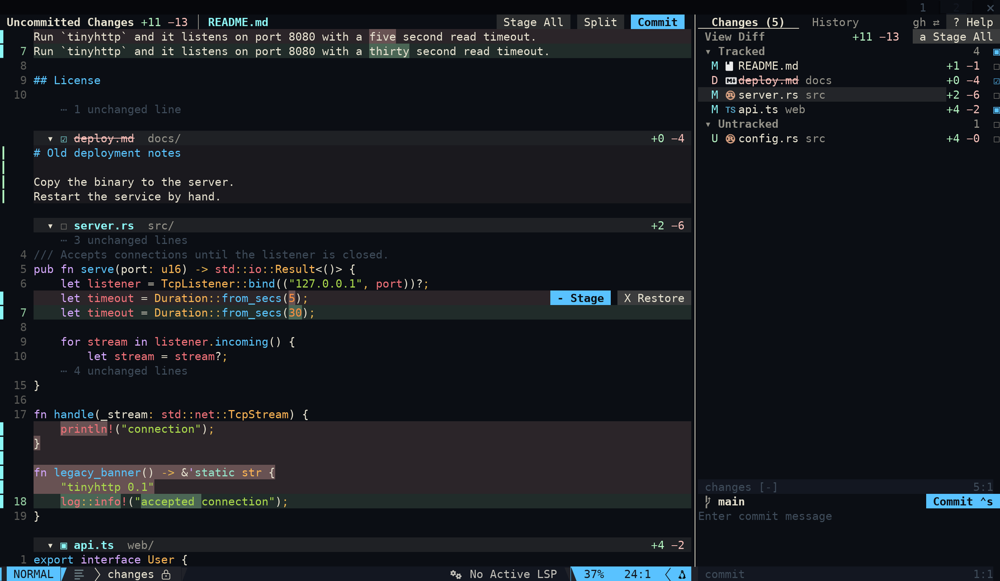
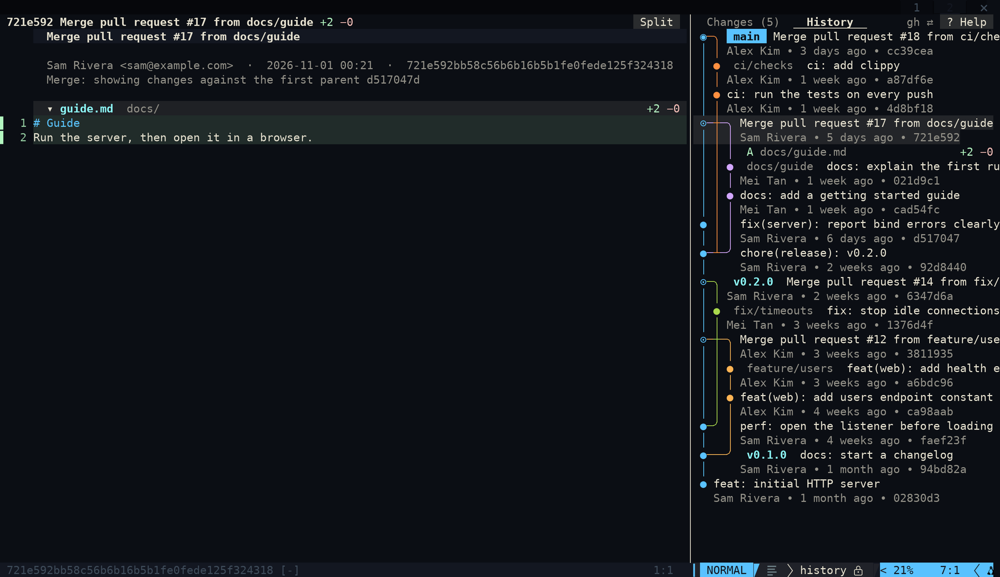
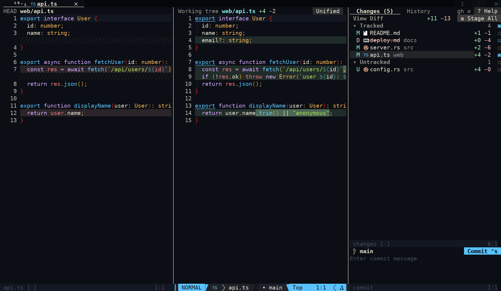

# differ

A git review view for Neovim, in the style of Zed and VSCodium. It opens in its own tabpage:

- **Uncommitted Changes:** every changed file in one continuous, scrollable buffer, with word-level highlights and syntax colours.
- **Edit in the diff:** added and context lines are real text. Change them with normal vim editing, then `:w` writes each file back.
- **Stage from anywhere:** toggle a hunk, selected lines, a file or everything. Staged hunks are shown differently from unstaged ones.
- **History:** a commit graph with coloured lanes, merges and ref badges. Move through it and each commit's diff follows.
- **Side by side:** native diff mode, with your real file buffer on the right so LSP and formatting keep working.
- **Commit box:** commit, amend, push, pull and fetch.



| History graph | Side by side |
| --- | --- |
|  |  |

Everything is an ordinary nvim window and buffer, so `<C-hjkl>`, leader maps and your other global maps keep working. Differ's own keys are buffer-local.

Developed and tested on Neovim 0.12; 0.11+ should work but is untested. Needs git 2.38+. A Nerd Font and `nvim-web-devicons` are optional. Treesitter parsers give syntax colours in the unified view when they're installed.

## Install

### nvf (flake)

Add the input to `flake.nix`. Differ has no flake of its own, so use `flake = false`:

```nix
differ = {
  url = "github:daschinmoy21/differ";
  flake = false;
};
```

Then in your nvf settings:

```nix
extraPlugins = with pkgs.vimPlugins; {
  differ = {
    package = pkgs.vimUtils.buildVimPlugin {
      pname = "differ";
      version = "0.1.0";
      src = inputs.differ;
    };
    setup = "require('differ').setup({})";
  };
};

keymaps = [
  { key = "<leader>gd"; mode = ["n"]; action = "<cmd>Differ<cr>"; desc = "Differ: changes"; }
  { key = "<leader>gh"; mode = ["n"]; action = "<cmd>Differ history %<cr>"; desc = "Differ: file history"; }
];
```

Run `nix flake update differ` to pick up new versions.

To try it without installing anything:

```sh
git clone https://github.com/daschinmoy21/differ ~/differ
nvim --cmd 'set rtp+=~/differ'
```

### lazy.nvim / LazyVim

```lua
{
  "daschinmoy21/differ",
  cmd = "Differ",
  keys = {
    { "<leader>gd", "<cmd>Differ<cr>", desc = "Differ: changes" },
    { "<leader>gh", "<cmd>Differ history %<cr>", desc = "Differ: file history" },
  },
  opts = {},
}
```

## Commands

| Command | What it does |
| --- | --- |
| `:Differ` | Open the view, or close it if you're already in it |
| `:Differ open` / `close` / `refresh` | Exactly that |
| `:Differ history` | Open the commit graph |
| `:Differ history %` | Graph limited to one file |
| `:Differ help` | Show the key cheatsheet, with or without an open view |

## Keys

Press `g?` in any Differ window, `?` or the **Help** button in the sidebar, or run `:Differ help` for a list that reflects your config. `:help differ` has the full docs, and if you use [cheatsheet.nvim](https://github.com/sudormrfbin/cheatsheet.nvim), `:Cheatsheet` lists Differ's default keys too. Every key can be changed or disabled in `setup()`.

**Diff (main pane)**

| Key | Action |
| --- | --- |
| `]c` `[c` | Next / previous hunk |
| `]f` `[f`, `L` `H` | Next / previous file |
| `-` | Stage or unstage the hunk; in visual mode, only the selected lines |
| `X` | Restore the hunk or selected lines to HEAD (asks first) |
| `<Tab>` | Collapse or expand the file |
| `<CR>` | Open the file at this line; on a `⋯` row, reveal hidden lines |
| `gA` `gR` | Stage all / unstage all |
| `gW` | Toggle line wrap |
| `:w` | Write your edits back to their files |

The hunk under the cursor also shows clickable **Stage** and **Restore** buttons.

**Changes tab**

| Key | Action |
| --- | --- |
| `<CR>` | Show the file; on a section, fold it |
| `-` / `s` / `u` | Toggle / stage / unstage (all work on a visual selection) |
| `X` | Discard changes (asks first; new files get deleted) |
| `a` `A` | Stage all / unstage all |
| `c` | Write a commit message |
| `p` `P` `f` | Pull (fast-forward only) / push / fetch |

**History tab**

| Key | Action |
| --- | --- |
| `<CR>` | Show the commit |
| `<Tab>` | List the commit's files under it |
| `a` | Current branch / all branches |
| `y` | Yank the commit hash |

**Commit box:** `<C-s>`, `<C-CR>` or `:w` commits. `<M-a>` toggles amend.

**Everywhere:** `gh` switch between Changes and History (and focus the sidebar), `gS` unified / side by side, `gC` commit box, `R` refresh, `q` close. In the sidebar, `H` and `L` also switch tabs.

Mouse: tabs, toolbar buttons, stage buttons, checkboxes and chevrons are all clickable.

## Things worth knowing

- **Removed lines and headers are protected.** Typing on one gives `E21`, and a change that spans one (like `dG`) is undone as a whole.
- **Rendering clears undo history.** Undo works while you edit. Writing with `:w`, staging or a refresh re-renders the buffer, and you can't undo past that. Staging and restoring are refused while you have unsaved edits, so run `:w` first.
- **`:w` won't overwrite newer work.** A file that changed on disk since it was shown, or that has unsaved changes in another buffer, is skipped with a warning.
- **Large changes load lazily.** About 8,000 changed lines load up front and the rest load as you scroll. A file over 6,000 changed lines or 2 MB waits for `<CR>`. See `load_budget` and `max_file_lines`.
- **Push and pull can't ask for a password.** Use an SSH agent or a credential helper. Without one, they fail with git's error message.
- **Merge commits** are shown against their first parent.

## Configuration

These are the common options; `lua/differ/config.lua` has the full list, including all keys and icons.

```lua
require("differ").setup({
  sidebar = { position = "right", width = 46 },
  mode = "unified",        -- or "split"
  context = 3,             -- unchanged lines around each hunk
  follow = true,           -- moving through the sidebar previews in the main pane
  poll_ms = 3000,          -- re-check git while focused; 0 disables
  confirm_restore = true,
  history = { page = 200, all = false, max_lanes = 8 },
  keys = {
    stream = { stage = "-", restore = "X" }, -- set a key to false to leave it unmapped
  },
})
```

Colours come from your theme. To override them, set the `Differ*` highlight groups (see `lua/differ/highlight.lua`) after a `ColorScheme` event.

If you use lualine, you can hide its statusline on the sidebar and commit box by adding `differ-panel` and `gitcommit` to `options.disabled_filetypes.statusline`.

## Tests

```fish
nvim --headless --clean -u NONE -l tests/run.lua
```

The suite runs against real git in throwaway repositories, and covers the diff logic, the graph and the full UI headless.

## License

MIT. See [LICENSE](LICENSE).
